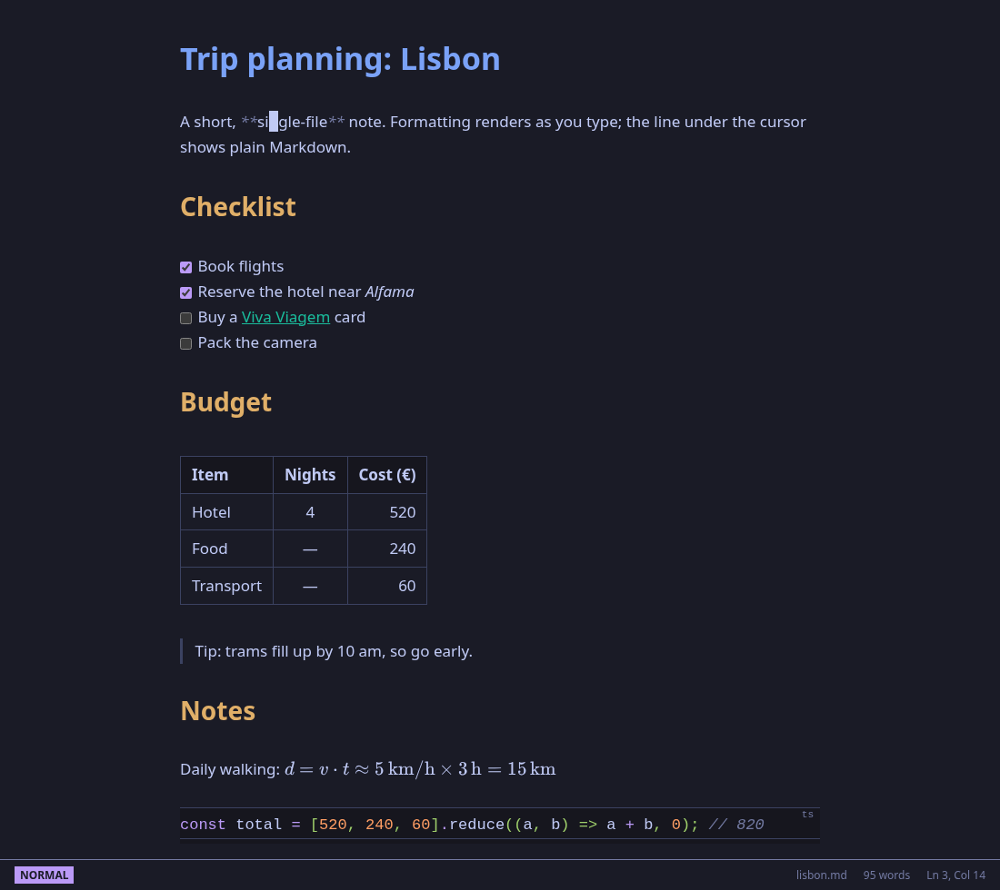

# mdw — markdown writer

A small, fast desktop editor for a single Markdown file, with Obsidian-style
live preview: formatting renders in place as you type and turns back into plain
Markdown on the line you are editing. There are no vaults, sidebars or
databases. You open one `.md` file, write, and save.

Built with [Tauri 2](https://tauri.app) (Rust) and
[CodeMirror 6](https://codemirror.net), without a UI framework.



## Features

- **Live preview** of headings, emphasis, links, lists, task lists, quotes,
  code blocks with syntax highlighting, tables, math (KaTeX) and images.
- **Vim keybindings**, on by default. Ctrl+Alt+V toggles them, and you can add
  custom mappings.
- **40+ themes**, including Tokyo Night, Catppuccin, Gruvbox, Kanagawa,
  Rosé Pine, Nord, Dracula and Solarized. You can add your own CSS themes.
- **Images**: paste a screenshot or drop a file. It is copied next to the
  document and linked with a relative path.
- **Links**: completion for file paths and headings, and `gx` / Ctrl+click to
  follow a link and Ctrl+O to come back.
- **Housekeeping**: rename a document together with its images, find
  unreferenced images, and list broken links.
- **Fast startup**: an optional background server keeps a window preloaded,
  so files open in about 0.1 s.

## Speed and memory

| How it runs | Time to first content | Memory |
|---|---|---|
| Background server (default) | ~0.1 s | ~200 MB while idle, plus more for each open window |
| `mdw --no-server` | ~0.4 s | Used only while a window is open |

The first `mdw` you run starts a small server that keeps one editor window
preloaded and hidden, so later files open almost instantly. The memory
figure counts the server and its WebKit processes, with shared libraries
split across processes (PSS). Check it with `mdw --server-status`. Free the
memory with `mdw --stop-server`, or set `server = false` in the config to
always run without the server.

These numbers were measured on Fedora with WebKitGTK and a 50-line sample
document. Your results will vary with the hardware and the document.

## Platform

Linux. It has been tested on Fedora with WebKitGTK. macOS may work but is
untested, and Windows is not supported.

## Install from source

You need [Rust](https://rustup.rs), [Node.js](https://nodejs.org) 20 or newer,
and the [Tauri system dependencies](https://tauri.app/start/prerequisites/#linux).
On Fedora:

```sh
sudo dnf install gcc webkit2gtk4.1-devel openssl-devel librsvg2-devel
```

Then:

```sh
git clone https://github.com/linscafe/simple-markdown-writer.git
cd simple-markdown-writer
npm install
npx tauri build --no-bundle
install -m755 src-tauri/target/release/mdw ~/.local/bin/mdw
```

To also get an app-menu entry and "Open with mdw" for `.md` files, run
`scripts/install-local.sh` instead of the last two commands. It needs no sudo.
[`docs/packaging.md`](docs/packaging.md) covers building RPM, DEB and AppImage
packages and testing them.

## Usage

```sh
mdw notes.md          # open a file; a missing file is created on first save
mdw                   # pick a file
mdw --help            # all commands, including the background server
```

| Key | Action |
|---|---|
| `:w` / Ctrl+S | Save |
| `:q`, `:wq` | Quit, or save and quit |
| Ctrl+Shift+T | Theme picker |
| Ctrl+Alt+V | Toggle Vim mode |
| Ctrl+Shift+I | Insert an image |
| Ctrl+= / Ctrl+- / Ctrl+0 | Zoom in / out / reset |

The title bar has an **S** button (unrendered source), a **W** box for the
text column width in pixels (saved to `config.toml`), and a menu that opens
files, shows a table of contents, zooms, picks a theme, and opens Preferences
(`config.toml`).

Settings live in `~/.config/mdw/config.toml`. See
[`config.example.toml`](config.example.toml) for every option with its default.
[`docs/usage.md`](docs/usage.md) covers all commands and features, and
[`docs/development.md`](docs/development.md) covers building, testing and
benchmarks.

## License

[MIT](LICENSE)
